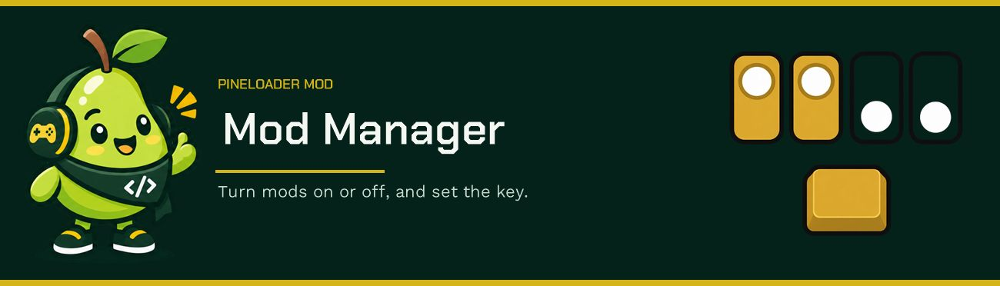
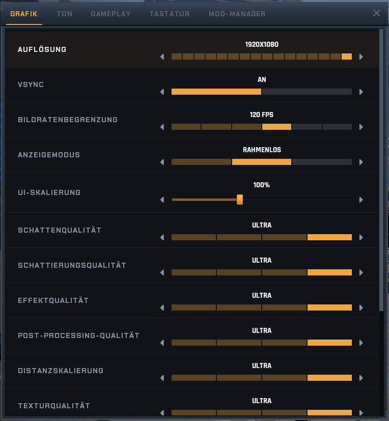
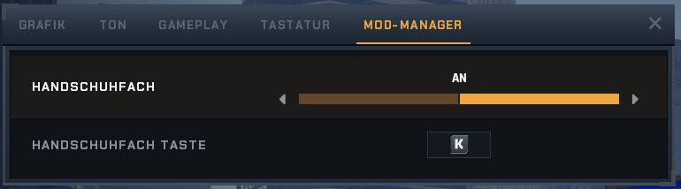
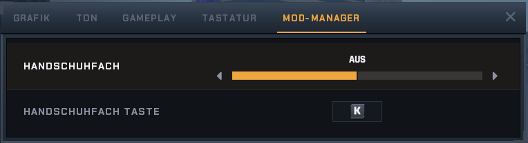
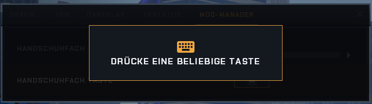

  

  <a href="https://github.com/EuroCent82/ModManager">GitHub</a>
  &nbsp;·&nbsp;
  <a href="https://pineloader.dev">pineloader.dev</a>
  &nbsp;·&nbsp;
  <a href="https://github.com/EuroCent82/PineLoader">PineLoader</a>

  Turns mods on and off in the settings. 
  The key has its own row.

  
  
  
  

  

Mod Manager is an optional [PineLoader](https://github.com/EuroCent82/PineLoader) mod for Pionero Capital. It adds a **Mod-Manager** tab after Keyboard in the game's settings. Each loaded mod gets the same on/off bar the game uses for VSync, and a second row for its key. That key row uses the game's own key button.

Glovebox does not need this mod. Without Mod Manager, Glovebox still reads `Config/Glovebox.ini` and still opens on its key.

The pictures are the German game. The labels follow the language of the game.

## Settings

The Mod-Manager tab sits after Keyboard.

  

## The switch

On and off use the same bar as VSync. In German the row reads Handschuhfach.

  

Off leaves the saved items where they are.

  

## Key

The key row uses the game's own key button. Pressing it asks for any key.

  

## Install

PineLoader has to be installed first. Close the game.

1. Download [Mod Manager 1.0.2](https://github.com/EuroCent82/ModManager/releases/latest). The file is `ModManager-1.0.2.zip`.
2. Copy the `ModManager` folder from that zip into `PineLoader/Mods`. The folder needs `ModManager.dll`.
3. Start the game from Steam.
4. Open Settings. The new tab sits after Keyboard.

The first time the tab is missing, start the game once through PineLoader so the menu file can be prepared, then open Settings again. A copy of the menu file is kept under `PineLoader/Cache/` before it is changed.

Switching a mod writes `Running` in that mod's ini. Choosing a key writes `Key`. The game's own graphics, sound, gameplay, and keyboard pages stay as they are.

## License

Apache License 2.0. See [LICENSE](LICENSE).
